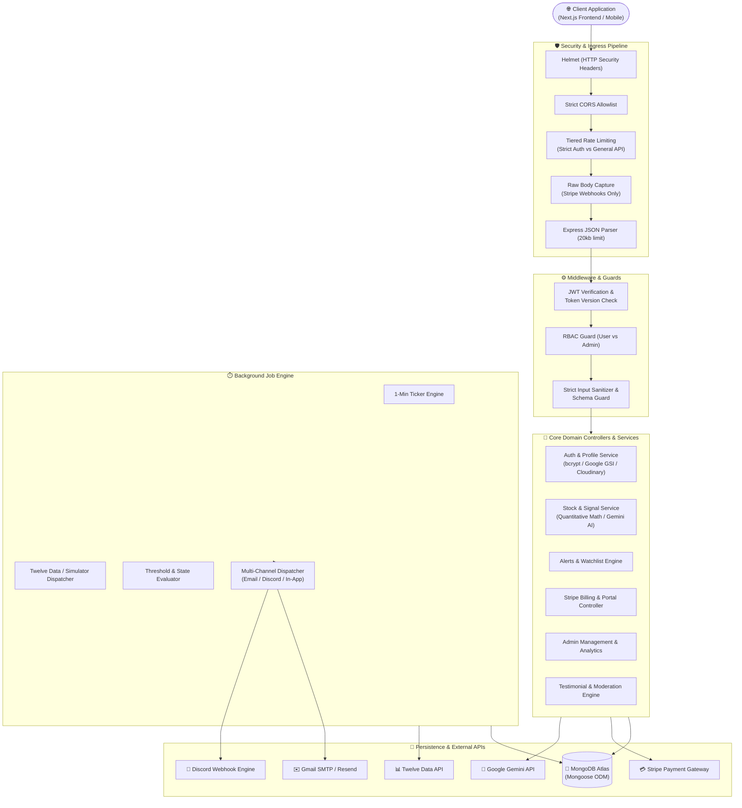

# 📈 StockSense API — Intelligent Market Analytics & Algorithmic Signal Engine

[](https://www.typescriptlang.org/)
[](https://nodejs.org/)
[](https://expressjs.com/)
[](https://mongoosejs.com/)
[](https://stripe.com/)
[](https://cloud.google.com/)
[](https://ai.google.dev/)
[](#license)

> **Enterprise-grade, high-throughput RESTful backend powering real-time quantitative stock analysis, multi-channel threshold alerts, tiered subscription billing, and AI-driven market intelligence.**

---

## 🌟 Executive Summary & Engineering Philosophy

Modern retail traders suffer from cognitive overload: volatile price charts, delayed indicators, and opaque algorithmic tools. **StockSense** was engineered from first principles to bridge the gap between complex Wall Street quantitative metrics and clean, explainable analytics.

This backend serves as the core computational engine. It is built with a strong emphasis on **deterministic financial accuracy**, **fault-tolerant asynchronous workers**, **resilient external integrations** (Stripe, Twelve Data, Google Gemini, Cloudinary), and **defense-in-depth security**.

### Why This Architecture Matters
* **No "Magic Numbers":** Market signals (Bullish, Bearish, Neutral) are derived through transparent, mathematically explainable momentum and moving-average deviation models.
* **Zero Lost Events:** Financial webhooks utilize strict HMAC-SHA256 signature verification, raw-body buffering, and idempotent database deduplication.
* **Deterministic Dual-Mode Data Engine:** Operates seamlessly with live Twelve Data API quotes during market hours, or transitions to an autonomous continuous Geometric Brownian Motion (GBM) market simulator for demo and off-hours testing without hitting third-party rate limits.
* **Fail-Safe Self-Healing:** Automatic out-of-band subscription reconciliation ensures users are never stuck in the wrong tier, even if network hiccups interrupt external webhooks.

---

## 📐 System Architecture

The service follows a modular, layered service architecture adhering to **Separation of Concerns (SoC)** and **Clean Code** principles:



---

## ⚡ Core Technical Features & Engineering Highlights

### 1. Dual-Engine Market Data Pipeline
- **Live Mode (`live`):** Integrates with Twelve Data REST endpoints. Features an intelligent request scheduler that throttles batch requests within free-tier limits (8 requests/minute, 800/day), caching daily closes and 1-day intraday points.
- **Continuous Simulation Mode (`simulated`):** Built for public deployment, automated testing, and candidate evaluation outside Wall Street trading hours (9:30 AM - 4:00 PM EST). Generates 1-year historic daily bars on initialization using a stochastic random-walk algorithm and emits dynamic ticks every minute with realistic price fluctuation, support/resistance drift, and volume spikes.

### 2. Quantitative Signal Generation Algorithm
Located in [`src/app/utils/signal.ts`](file:///e:/Projects-for-Cv/stocksense-ai-backend/src/app/utils/signal.ts), the signal generator removes emotional bias using a transparent dual-factor momentum formula:

$$\text{score} = \left(\frac{P_{\text{last}} - \overline{P}_{30}}{\overline{P}_{30}} \times 100\right) \times 0.6 + \left(\frac{P_{\text{last}} - P_{-5}}{P_{-5}} \times 100\right) \times 0.4$$

* **$\text{Score} > +0.8$:** **Bullish** (Confirmed upward moving-average breakout with 5-day momentum).
* **$\text{Score} < -0.8$:** **Bearish** (Price breakdown below 30-day mean coupled with negative momentum).
* **$-0.8 \le \text{Score} \le +0.8$:** **Neutral** (Consolidation range).
* **Dynamic Confidence Score:** Clamped dynamically between $48\%$ and $95\%$ based on momentum magnitude.
* **Support & Resistance:** Statistically calculated as the 30-day minimum and maximum with a $1\%$ breakout buffer.

### 3. Financial-Grade Stripe Subscription Lifecycle
- **Tamper-Proof Ingress:** Stripe webhooks require the raw, untouched request buffer for cryptographic HMAC-SHA256 signature verification.
- **Idempotent Webhook Processing:** Every event is persisted in a dedicated `WebhookEvent` collection before execution. Duplicate event retries from Stripe are acknowledged with `200 OK` and bypassed, preventing duplicate credit/upgrades.
- **Out-of-Band Auto-Reconciliation:** If local network firewalls block real-time webhooks, the backend runs an automated fallback check (`syncUserSubscription`) when a user visits billing/settings, inspecting active Stripe subscriptions directly via API.
- **Customer Portal Integration:** Generates on-demand Stripe Billing Portal sessions so customers can manage payment cards, view tax invoices, or cancel subscriptions without custom sensitive card-handling code.

### 4. Multi-Channel Alert & Notification Dispatcher
- **State-Aware Triggering (Hysteresis):** Prevents spamming. The alert engine tracks previous state transitions so "Turned Bullish" or "Crossed $150" only fires on the inflection point.
- **Concurrent Dispatch:** An alert fires concurrently across three distinct channels:
  1. **In-App:** Persisted to MongoDB notifications table with unread badges.
  2. **Email:** Sent via Gmail SMTP (Nodemailer) or Resend API with formatted responsive HTML.
  3. **Discord Integration:** Dispatched directly to the user's private Discord channel via custom Webhooks.

### 5. AI-Assisted Stock Summaries (Google Gemini)
- Queries Google's `gemini-2.5-flash` model with real-time quantitative context (current price, 52-week bounds, technical signal, momentum, volume).
- **Graceful Fallback:** If the AI quota is exceeded or network fails, the backend seamlessly falls back to a deterministic, rule-based algorithmic narrative.

---

## 🔒 Enterprise Security & Defensive Architecture

Security is treated as a first-class requirement across all layers:

* **Token Versioning & Instant Invalidation:** Every user record stores an integer `tokenVersion`. Changing passwords or administrative account blocks immediately increments this version, instantly revoking all active JWTs across all user devices.
* **Timing-Attack Resistant Authentication:** When an invalid email is provided during login, `bcrypt.compare` executes against a pre-computed `DUMMY_HASH` to guarantee constant-time execution, preventing malicious email enumeration.
* **NoSQL Injection Immunity:** All route inputs are strictly checked for types, lengths, and regex sanitization, neutralizing MongoDB operator injection attacks (e.g., `{ "$ne": "" }`).
* **Tiered Rate Limiting:**
  - `auth` endpoints (login, register, reset): Strict **30 requests per 15 minutes**.
  - General data endpoints: **600 requests per 15 minutes**.
* **Zero Sensitive Exposure:** Mongoose `.toJSON()` projection masks `passwordHash`, `resetOtp`, and internal token versions on all queries.

---

## 🗄️ Database Entity Schema (MongoDB)

```
┌──────────────────┐       1:N       ┌──────────────────┐
│      User        ├────────────────►│      Alert       │
│──────────────────│                 │──────────────────│
│ _id: ObjectId    │                 │ user: ObjectId   │
│ email: String    │                 │ symbol: String   │
│ planName: String │       1:N       │ conditions: Obj  │
│ tokenVersion: Int├────────┐        │ channels: Obj    │
│ stripeCustomerId │        │        └──────────────────┘
└────────┬─────────┘        │
         │                  │        ┌──────────────────┐
         │ 1:N              └───────►│     Invoice      │
         ▼                           │──────────────────│
┌──────────────────┐                 │ user: ObjectId   │
│   Notification   │                 │ tx: String       │
│──────────────────│                 │ amount: Number   │
│ user: ObjectId   │                 │ status: String   │
│ title: String    │                 └──────────────────┘
│ read: Boolean    │
└──────────────────┘
```

---

## 🔌 API Endpoint Directory

All private endpoints require `Authorization: Bearer <JWT_TOKEN>`. Standard responses conform to `{ ok: true, data: ... }` or standard error envelopes `{ message: "..." }`.

### 🔑 Authentication & Profile (`/api/auth`)
| Method | Path | Access | Description |
|---|---|---|---|
| `POST` | `/api/auth/signup` | Public | Register with name, email, and password |
| `POST` | `/api/auth/login` | Public | Authenticate user & issue 7-day versioned JWT |
| `POST` | `/api/auth/google` | Public | Verify Google OAuth2 ID Token and authenticate |
| `POST` | `/api/auth/forgot-password`| Public | Dispatch 6-digit OTP to user's verified email |
| `POST` | `/api/auth/verify-otp` | Public | Validate OTP and issue temporary 10-min reset ticket |
| `POST` | `/api/auth/reset-password` | Public | Reset password using valid reset ticket |
| `GET` | `/api/auth/me` | Authenticated | Retrieve current user profile and sync active subscription |
| `PATCH`| `/api/auth/me` | Authenticated | Update name or custom Discord webhook URL |
| `POST` | `/api/auth/me/discord/test`| Authenticated | Send test payload to configured Discord channel |
| `PATCH`| `/api/auth/me/password` | Authenticated | Update password and invalidate all previous active sessions |
| `POST` | `/api/auth/me/avatar/signature` | Authenticated | Generate signed ticket for direct Cloudinary upload |

### 📈 Stocks & Quantitative Analysis (`/api/stocks`)
| Method | Path | Access | Description |
|---|---|---|---|
| `GET` | `/api/stocks` | Public | Search and list symbols with price, 24h change, signal |
| `GET` | `/api/stocks/:symbol` | Public | Deep analysis: support, resistance, breakout, momentum |
| `GET` | `/api/stocks/:symbol/history`| Public | Historic data series (`1D`, `1W`, `1M`, `1Y`) |
| `GET` | `/api/stocks/:symbol/summary`| Public | AI-generated market summary (Gemini / Algorithmic) |
| `GET` | `/api/stocks/market/bias` | Public | Broad market index bias (SPY, QQQ, IWM) |
| `GET` | `/api/stocks/market/status` | Public | Health status, current data mode, and last refresh timestamp |

### 🚨 Watchlist & Automated Alerts (`/api/watchlist`, `/api/alerts`)
| Method | Path | Access | Description |
|---|---|---|---|
| `GET` | `/api/watchlist` | Authenticated | Retrieve user watchlist with live quotes |
| `POST` | `/api/watchlist` | Authenticated | Add ticker (enforces Free plan limit: 5 stocks) |
| `DELETE`| `/api/watchlist/:symbol` | Authenticated | Remove symbol from watchlist |
| `GET` | `/api/alerts` | Authenticated | List configured alerts with filter (`active`, `disabled`) |
| `POST` | `/api/alerts` | Authenticated | Create multi-condition alert (price, signal, breakout, volume) |
| `PATCH`| `/api/alerts/:id` | Authenticated | Toggle alert state or adjust threshold boundaries |
| `DELETE`| `/api/alerts/:id` | Authenticated | Remove alert rule |

### 💳 Subscriptions & Payments (`/api/billing`)
| Method | Path | Access | Description |
|---|---|---|---|
| `GET` | `/api/billing` | Authenticated | Current plan details, renewal date, and invoice history |
| `POST` | `/api/billing/checkout` | Authenticated | Create Stripe Checkout session for monthly/yearly plan |
| `POST` | `/api/billing/portal` | Authenticated | Generate Stripe Customer Portal session link |
| `POST` | `/api/billing/webhook` | Stripe Only | Webhook endpoint receiving raw signed Stripe events |

### 💬 Testimonials & Reviews (`/api/reviews`)
| Method | Path | Access | Description |
|---|---|---|---|
| `GET` | `/api/reviews/public` | Public | Approved reviews displayed on public landing page |
| `GET` | `/api/reviews/mine` | Authenticated | Get current user's review |
| `POST` | `/api/reviews` | Authenticated | Create or update user review |
| `DELETE`| `/api/reviews/mine` | Authenticated | Remove user review |

### 🛡️ Administration & Platform Governance (`/api/admin`)
| Method | Path | Access | Description |
|---|---|---|---|
| `GET` | `/api/admin/stats` | Admin | High-level platform KPIs (revenue, users, paid ratio) |
| `GET` | `/api/admin/users` | Admin | Paginated user management with search & filter |
| `PATCH`| `/api/admin/users/:id/block`| Admin | Instantly block or unblock user access |
| `GET` | `/api/admin/billing` | Admin | Global invoice ledger with revenue aggregation |
| `GET` | `/api/admin/reviews` | Admin | Review moderation queue (search, filter by status) |
| `PATCH`| `/api/admin/reviews/:id/status` | Admin | Approve or reject testimonials |
| `DELETE`| `/api/admin/reviews/:id` | Admin | Permanently delete abusive review |
| `POST` | `/api/admin/plans` | Admin | Create new pricing tier |
| `PUT` | `/api/admin/policy/:key` | Admin | Update Terms of Service or Privacy Policy |

---

## 🚀 Getting Started

### Prerequisites
* **Node.js**: `v20.x` or `v22.x` (LTS recommended)
* **MongoDB**: Local instance or free [MongoDB Atlas Cluster](https://www.mongodb.com/atlas)
* **npm** or **pnpm**

### 1. Clone & Install
```bash
git clone https://github.com/your-username/stocksense-ai-backend.git
cd stocksense-ai-backend
npm install
```

### 2. Environment Configuration
Create a `.env` file in the root directory:
```bash
# Windows
copy .env.example .env
# Mac / Linux
cp .env.example .env
```

Configure the essential keys:
```env
PORT=5000
NODE_ENV=development
CLIENT_URL=http://localhost:3000

# MongoDB
MONGODB_URI=mongodb+srv://<user>:<password>@cluster0.xxxxx.mongodb.net/stocksense?retryWrites=true&w=majority

# Security (Generate with: node -e "console.log(require('crypto').randomBytes(48).toString('hex'))")
JWT_SECRET=your_super_secret_64_character_hex_key
JWT_EXPIRES=7d

# Market Mode ("live" or "simulated")
MARKET_DATA_MODE=simulated
TWELVE_DATA_API_KEY=your_key_here

# Email Delivery (Gmail SMTP or Resend)
MAIL_PROVIDER=smtp
SMTP_HOST=smtp.gmail.com
SMTP_PORT=587
SMTP_USER=your_email@gmail.com
SMTP_PASS=your_gmail_app_password

# Stripe Payments
STRIPE_SECRET_KEY=sk_test_...
STRIPE_WEBHOOK_SECRET=whsec_...

# Google OAuth2
GOOGLE_CLIENT_ID=your_client_id.apps.googleusercontent.com
```

### 3. Database Seeding
Initialize the default plans, stock symbols, legal policies, and the primary administrator account:
```bash
npm run seed
```
*(Optional for local development)* Populate realistic demo users and sample customers:
```bash
npm run seed:sample
```

| Default Role | Email | Password |
|---|---|---|
| **Platform Administrator** | `admin@stocksense.dev` | `Admin@12345` |
| **Demo User (Premium)** | `demo@stocksense.dev` | `Demo@12345` |

### 4. Run Development Server
```bash
npm run dev
```
The API boots on `http://localhost:5000`. Hot-reloading is managed via `tsx watch`.

---

## 🧪 Testing & Quality Assurance

The codebase includes an extensive automated test suite covering unit calculations, database models, job schedulers, and payment flows:

```bash
# Run unit & mock tests
npm test

# Run end-to-end database tests against an Atlas test cluster
TEST_MONGODB_URI="mongodb+srv://..." npm test

# Execute live 60-point API smoke check
npm run smoke

# TypeScript type validation
npm run typecheck
```

### Smoke Test Suite (`npm run smoke`)
A dedicated command-line verification script ([`src/app/scripts/smoke.ts`](file:///e:/Projects-for-Cv/stocksense-ai-backend/src/app/scripts/smoke.ts)) asserts that all core endpoints, authorization headers, rate limits, and market calculators respond with correct HTTP status codes and contract payloads in under 5 seconds.

---

## 🌐 Deployment Guidelines

### Option A: Serverless on Vercel
1. Ensure your MongoDB Atlas cluster allows connections from all IPs (`0.0.0.0/0`).
2. Add all `.env` variables into **Vercel Project Settings → Environment Variables**.
3. Deploy directly via Vercel Git integration.

### Option B: Long-Running Process on VPS / Render
Recommended for uninterrupted background ticker jobs and instant email delivery:
1. **Build Command:** `npm install --include=dev && npm run build`
2. **Start Command:** `npm start`
3. Configure `MARKET_DATA_MODE=simulated` or provide live market keys.

---

## 👨‍💻 Engineering Reflection & Author Notes

> *"Great software is not just about making code work; it's about making code resilient, secure, maintainable, and obvious to the next developer who reads it."*

Building StockSense API allowed me to address real-world software engineering complexities:
1. **Designing idempotent billing pipelines** that withstand dropped network connections.
2. **Constructing financial simulations** that respect statistical bounds without relying on expensive live market-data subscriptions during prototyping.
3. **Balancing strict security controls** (timing-attack protections, token versioning, rate limiting) with high developer ergonomics.

---

## 📄 License
Distributed under the **MIT License**. See `LICENSE` for more information.
